class: cover
name: welcome

# Git & GitHub

.cover-figure[]

.subtitle[Tianyou Yu]

.subtitle[October 2026]

???
Suggested pace: 60–75 minutes, with time to run the examples. Use macOS Terminal, Linux, or Git Bash on Windows. Arrow keys navigate, P shows these notes, and ? opens Remark's help. The example stays in my-first-project throughout. Letters such as A and B stand for commit IDs; actual hashes differ.

---
name: why-git

# Why use Git?

.left[
```text
index-final.html
index-final-v2.html
index-final-REALLY-final.html
```
]
.right[
Git tracks changes to your files.

You can compare saved versions and see who changed what.

You choose which changes to commit.
]
.clear[]

???
Git records changes when you commit. It does not save every keystroke or prevent all conflicts. Source: https://git-scm.com/book/en/v2/Getting-Started-About-Version-Control

---
class: compare
name: git-vs-github

# Git and GitHub

.left[
## Git

Runs on your computer.

Saves commits, compares versions, and manages branches.

Works offline.
]
.right[
## GitHub

Hosts Git repositories online.

Shares branches with a team and provides pull requests, reviews, and checks.
]
.clear[]

???
A local commit is not automatically uploaded. GitHub is one hosting service; the Git commands also work with other hosts. Checks run only when configured. Source: https://docs.github.com/en/get-started/start-your-journey/about-github-and-git

---
name: repository-and-commit

# Repositories and commits

A repository stores your project's history, usually in a hidden `.git` directory.

A commit saves a snapshot of the tracked files.

.figure[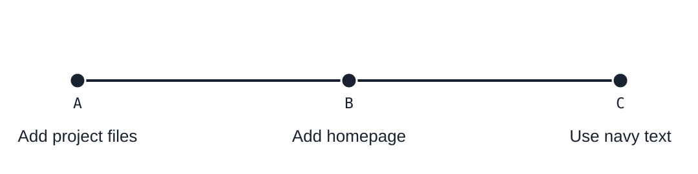]

???
This previews the first three commits we will make. Each commit records a snapshot, metadata and any parent commits. The first commit has no parent. A merge commit can have two parents. Untracked files are absent until added. Source: https://git-scm.com/book/en/v2/Getting-Started-What-is-Git%3F

---
name: setup

# Before the first commit

```bash
git --version
git config --global user.name "Your Name"
git config --global user.email "you@example.com"
```

Use your own name and email. Git attaches them to your commits.

.note[GitHub provides a no-reply email address if you prefer to keep your email private.]

VS Code’s built-in Git tools use the same repository as the terminal.

.note[Screenshots: VS Code 1.137, Dark Modern, Chinese UI. The action names here are in English.]

???
Install Git first. In VS Code, use View > Source Control. F1 opens the Command Palette; on macOS use Shift+Command+P, and on Windows/Linux use Ctrl+Shift+P. No Git extension is required for the operations shown.  The examples use Git 2.28 or newer for init -b; switch and restore require 2.23 or newer. --global sets the default identity for this user, not a GitHub login. Use the no-reply address in GitHub Settings > Emails if needed. Sources: https://git-scm.com/book/en/v2/Getting-Started-First-Time-Git-Setup and https://docs.github.com/en/account-and-profile/how-tos/email-preferences/setting-your-commit-email-address

---
class: compare compact-code
name: project

# Our example project

.left[
```text
my-first-project/
├── README.md
├── index.html
└── style.css
```

Create these files in your editor, or copy the starter folder in `examples/`.
]
.right[
`README.md`
```markdown
# My first project
```

`index.html`
```html
<h1>Hello</h1>
```

`style.css`
```css
body { color: #222; }
```
]
.clear[]

???
Work in a new folder. The three files are deliberately small: they are Git practice files, not a complete website template. The HTML is not linked to the stylesheet; changes to style.css are tracked as file changes in this lesson. Keep the same terminal and repository open for the following steps.

---
class: command
name: init

# git init

.left[
```bash
cd my-first-project
git init -b main
```

Git adds `.git` to this folder.

The three project files stay as they are. There are no commits yet.

.gui-path[VS Code · Command Palette → **Git: Initialize Repository**]

.gui-shot[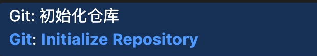]
]
.right[
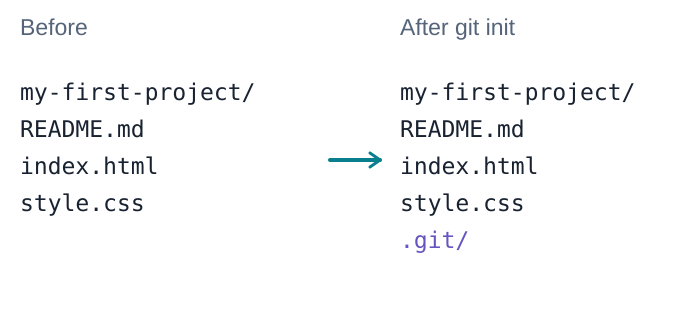
]
.clear[]

???
The GUI command asks which folder to initialize. Select my-first-project. The screenshot is a real local command result, not a drawn interface. The demo profile sets git.defaultBranchName to main; other installations may choose another initial name. Do not initialize the parent folder. Source: https://code.visualstudio.com/docs/sourcecontrol/quickstart

main is a branch name, not a special keyword. With no commits, HEAD names an unborn main branch. No remote is configured and nothing is uploaded. Source: https://git-scm.com/docs/git-init

---
name: three-areas

# The three local areas

.figure[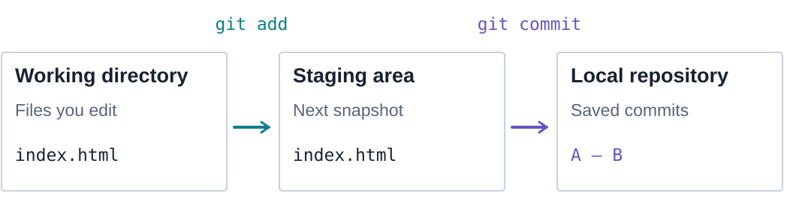]

The staging area holds the contents you want in the next commit.

???
Working directory is also called working tree. Staging area is also called index. These are roles, not three folders that files move through. The files remain in the working directory. Source: https://git-scm.com/book/en/v2/Getting-Started-What-is-Git%3F

---
class: command
name: initial-stage

# Stage the starting files

.left[
```bash
git add .
```

Here, `.` includes the three files in our project folder.

Now their contents are staged, but there is no commit yet.

.gui-path[VS Code · Hover over **Changes** → **+** to stage all three files.]
]
.right[
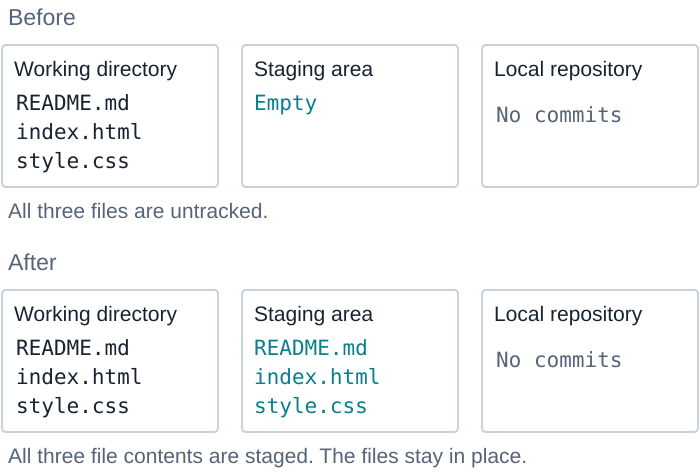
]
.clear[]

???
Run from the project root, with only the three practice files present. git add . stages changes under the current directory, respecting ignore rules. In a real project, inspect status and the staged diff before committing. It copies content into the index rather than moving files. Source: https://git-scm.com/docs/git-add

---
class: command
name: initial-commit

# Save the first version

.left[
```bash
git commit -m \
  "Add project files"
```

Commit **A** contains all three files.

It is saved locally.

.gui-path[VS Code · Enter **Add project files**, then **Commit**.]
]
.right[
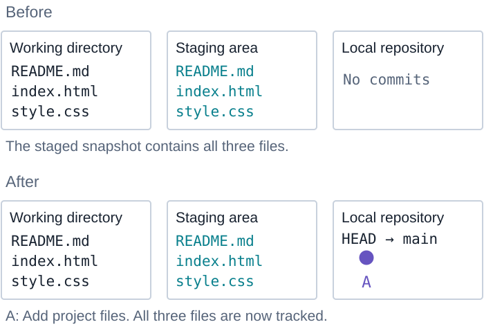
]
.clear[]

???
The backslash continues a shell command onto the next line. You can also type it on one line. git commit -m records the staged snapshot and advances the current branch. A is a teaching label. Source: https://git-scm.com/docs/git-commit

---
class: command
name: edit

# Change index.html

.left[
In your editor, replace the heading:

```html
<h1>My homepage</h1>
```

Only the working file changes.

The stage and commit A still contain “Hello”.
]
.right[
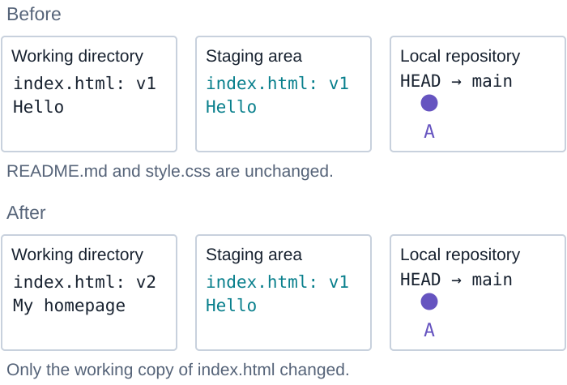
]
.clear[]

???
Save the file in the editor. We call the original content v1 and the new content v2 in the diagrams. Those are content labels, not filenames. README.md and style.css are unchanged. Editing a file does not stage or commit it.

---
class: compare compact-code
name: inspect

# Inspect the change

.left[
```bash
git status --short
```
.output[
```text
 M index.html
```
]

The second column shows an unstaged change.
]
.right[
```bash
git diff
```
.output[
```diff
-<h1>Hello</h1>
+<h1>My homepage</h1>
```
]

Both commands only read the state.
]
.clear[]

???
The diff omits file headers and context. The first status column compares the index with HEAD; the second compares the working tree with the index. A new untracked file would appear as ?? and would not appear in plain git diff. Sources: https://git-scm.com/docs/git-status and https://git-scm.com/docs/git-diff

---
class: compare compact-code gui-read
name: inspect-vscode

# Inspect it in VS Code

.left[
```bash
git status --short
```

.gui-shot[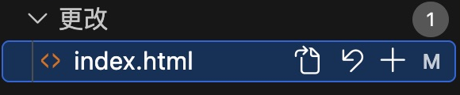]

**Source Control → Changes**

`M` marks the modified file.
Opening the panel does not change Git.
]
.right[
```bash
git diff
```

.gui-shot[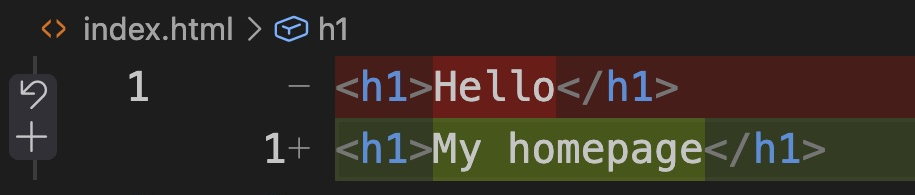]

**Click `index.html` in Changes.**

The diff compares the working file with the stage.
]
.clear[]

.note[View → Source Control. Use the Command Palette for commands that start with “Git:”.]

???
The screenshot excerpts are from the same saved homepage edit, before staging. In Source Control, Changes shows unstaged edits; Staged Changes shows edits prepared for the next commit. Selecting a file opens a diff but does not stage or commit it. The screenshot uses the built-in inline diff view to keep both changed lines readable. A file can appear in both lists after staging and then editing again. Source: https://code.visualstudio.com/docs/sourcecontrol/staging-commits

---
class: command
name: add

# git add index.html

.left[
```bash
git add index.html
git diff --staged
```

The homepage edit is now staged.

.gui-path[VS Code · Hover over `index.html` in **Changes** → **+ Stage Changes**.]

.gui-shot[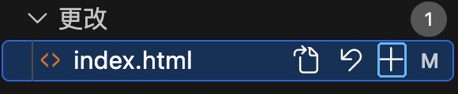]

]
.right[
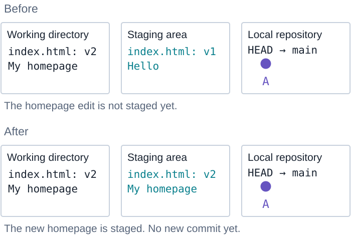
]
.clear[]

???
In the screenshot, the blue outline marks the real plus icon. Clicking it was verified to change the index from Hello to My homepage without changing HEAD. To inspect the same staged diff in VS Code, select index.html under Staged Changes. Source: https://code.visualstudio.com/docs/sourcecontrol/staging-commits

The query command does not change the diagram. Only git add changes the index. The staged snapshot still includes the unchanged README.md and style.css from A. Source: https://git-scm.com/docs/git-add

---
class: command compact-code
name: unstage

# Unstage the change

.left[
```bash
git restore --staged index.html
```

.gui-path[VS Code · In **Staged Changes**, click **− Unstage Changes**.]

.gui-shot[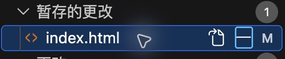]

Then stage it again:
```bash
git add index.html
```
]
.right[
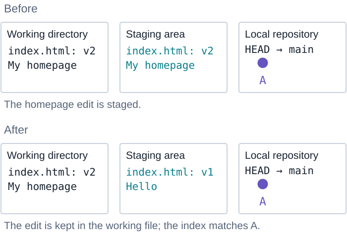
]
.clear[]

???
This is a short detour in the same example: unstage, observe, then stage again before the quiz and commit B. The diagram shows only the unstage operation. The final git add returns to the previous staged state. Unstage Changes is different from Discard Changes (the curved arrow), which can lose working edits. The real minus action was checked against Git: the index matched A, the working file still contained v2, and HEAD did not move. The built-in UI may run git reset internally; the state effect here is the same as restore --staged. Source: https://code.visualstudio.com/docs/sourcecontrol/staging-commits

---
class: quiz
name: staging-check

# What if you edit again?

.question[Suppose you stage v2, then edit `index.html` to v3. Which version will `git commit` save?]

.figure[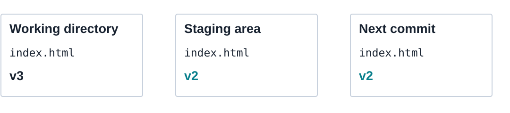]

???
This is a hypothetical question, not another step to execute in the current project. Pause before revealing the answer. The real exercise still has v2 in both the working file and staging area.

--

.answer[The staged version, v2. Run `git add` again to include v3.]

???
The plain commit command records the index. Later edits need another add. git diff would show the unstaged v3 edit. Source: https://git-scm.com/docs/git-add

---
class: command
name: commit

# git commit

.left[
```bash
git commit -m "Add homepage"
```

.gui-path[VS Code · Enter **Add homepage**, then click **Commit**.]

.gui-shot[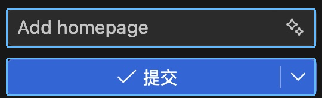]

Commit **B** saves the staged snapshot locally.
]
.right[
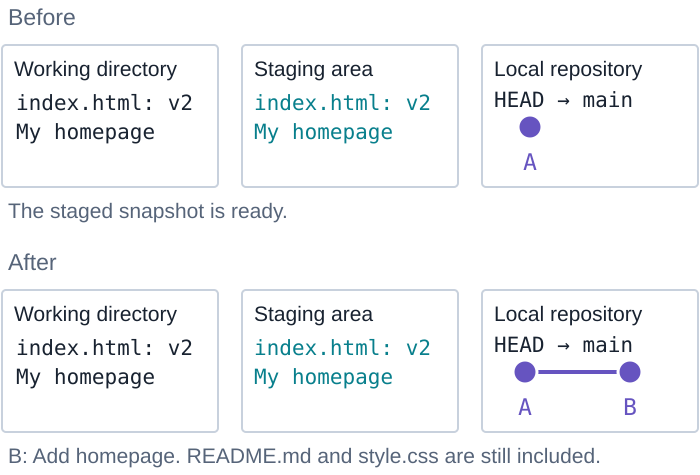
]
.clear[]

???
The plain Commit action is used, not Commit & Push or Commit & Sync. Stage explicitly before committing: smart commit settings can otherwise offer to stage additional changes. The real GUI commit was checked to create B with the expected message and a clean working tree. Source: https://code.visualstudio.com/docs/sourcecontrol/staging-commits

Continue the actual exercise with v2 in the working tree and index. After this commit, git status should report a clean working tree. A commit is a project snapshot, not only the edited file. Source: https://git-scm.com/docs/git-commit

---
class: command compact-code
name: log

# Read the history

.left[
```bash
git log --oneline
```
.output[
```text
eb61273 Add homepage
fac24ee Add project files
```
]

The newest commit appears first.
Your IDs will be different.
]
.right[
.gui-path[VS Code · **Source Control Graph**]

.gui-shot[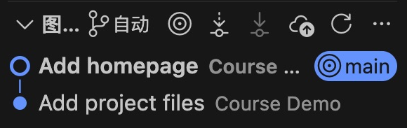]

B is above A. `main` points to B.

Selecting a commit lets you inspect it.
]
.clear[]

???

The output hashes are examples. These are commits B and A. Logs normally show newest first, while our diagrams read oldest to newest from left to right. Press q if Git opens a pager. log and status do not change files or references. Source: https://git-scm.com/docs/git-log

The Graph is built in to this VS Code version; these screenshots do not use GitLens or Git Graph extensions. Inspecting a commit is read-only. Checkout (Detached) is a different action that changes HEAD and working files. Source: https://code.visualstudio.com/docs/sourcecontrol/history

---
class: command
name: branch

# Create a branch

.left[
```bash
git branch add-style
```

`add-style` starts at B.

You are still on `main`.
]
.right[
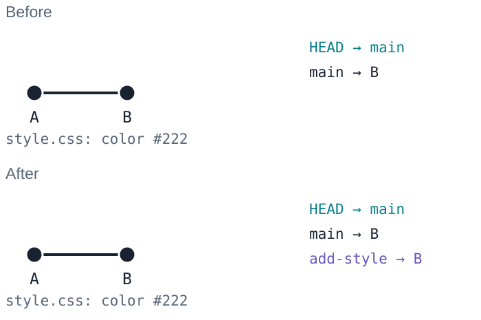
]
.clear[]

???
VS Code’s Create Branch... command also switches to the new branch. It corresponds to git switch -c, not to this create-only git branch operation. We will use that shortcut on the add-footer slide.

A branch is a movable name for a commit. Creating it does not copy all the files or switch the current branch. HEAD usually points to the branch you are on. Source: https://git-scm.com/docs/git-branch

---
class: command
name: switch

# Switch to the branch

.left[
```bash
git switch add-style
```

HEAD now names `add-style`.

The files look the same because both branches point to B.

.gui-path[VS Code · Click the current branch in the **Status Bar**, then choose `add-style`.]

.gui-shot[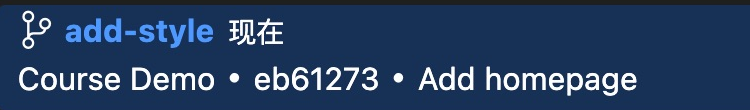]
]
.right[
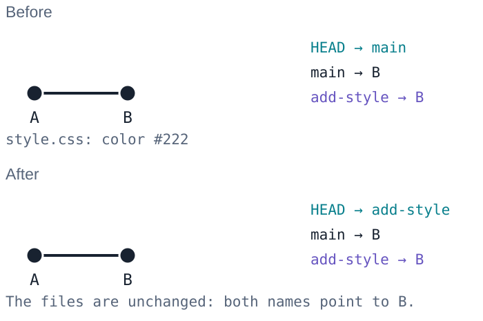
]
.clear[]

???
git switch -c add-style would create and switch in one command, but do not run it now because this branch already exists. Older tutorials may use checkout for switching branches. Commit or otherwise preserve unfinished work before switching. Source: https://git-scm.com/docs/git-switch

---
class: command compact-code
name: branch-commit

# Save a change on add-style

.left[
In `style.css`, change the color:

```css
body { color: navy; }
```

```bash
git add style.css
git commit -m "Use navy text"
```
]
.right[
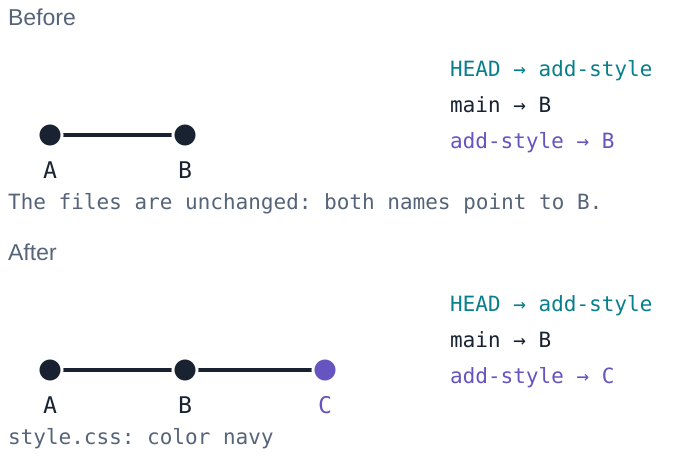
]
.clear[]

???
This creates C. The current branch advances to C, while main stays at B. Branching and committing work offline. To inspect both tips, run git log --oneline --graph --all --decorate.

---
class: command
name: switch-main

# Switch back to main

.left[
```bash
git switch main
```

`style.css` uses `#222` again.

The navy version is still saved in C on `add-style`.

.gui-path[VS Code · Status Bar branch name → **main**.]
]
.right[
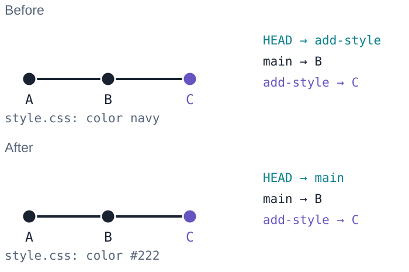
]
.clear[]

???
The branch tips do not move when you switch. Git checks out the files for the selected branch when it is safe to do so. It can carry some non-conflicting local edits across a switch, so use a clean working tree in this exercise. Source: https://git-scm.com/docs/git-switch

---
class: command
name: fast-forward

# Merge add-style

.left[
```bash
git merge add-style
```

`main` moves from B to C.

This is a **fast-forward**. Git creates no extra commit.

`style.css` now uses navy.

.gui-path[VS Code · On **main**, run **Git: Merge…**, then select `add-style`.]

.gui-shot[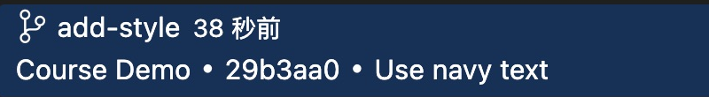]
]
.right[
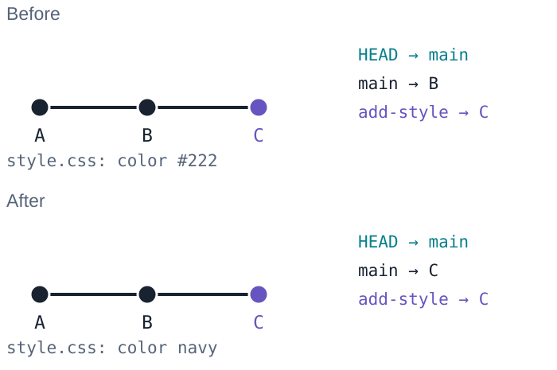
]
.clear[]

???
The installed built-in command is named Git: Merge.... Select the source branch while already on main. The GUI fast-forward was executed and verified: main became C with no additional commit and style.css became navy. Source: https://code.visualstudio.com/docs/sourcecontrol/branches-worktrees

main has no new commits beyond B, so a fast-forward is possible. This assumes the usual merge.ff setting. git merge --ff-only add-style would require that result explicitly. Source: https://git-scm.com/docs/git-merge#_fast_forward_merge

---
class: command compact-code
name: footer-branch

# Add a footer on another branch

.left[
```bash
git switch -c add-footer
```

.gui-path[VS Code · **Git: Create Branch…** → `add-footer`. This also switches branches.]

Append to `index.html`:

```html
<footer>Made with Git.</footer>
```

```bash
git add index.html
git commit -m "Add footer"
```
]
.right[
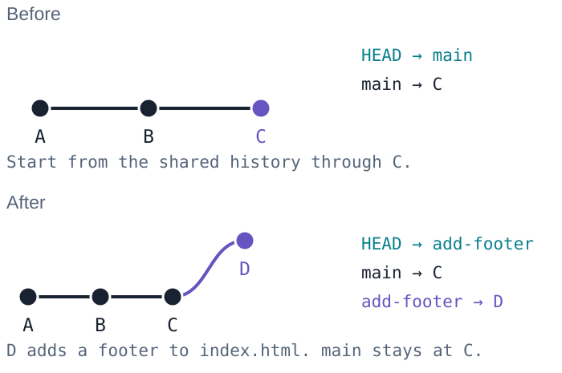
]
.clear[]

???
Keep the homepage heading in index.html and add the footer on the following line. D contains the footer, the homepage, the navy CSS and the existing README. This continues the same repository after the fast-forward.

---
class: command compact-code
name: main-change

# main changes too

.left[
```bash
git switch main
```

Add a line to `README.md`:

```text
A small website for learning Git.
```

```bash
git add README.md
git commit -m "Describe project"
```
]
.right[
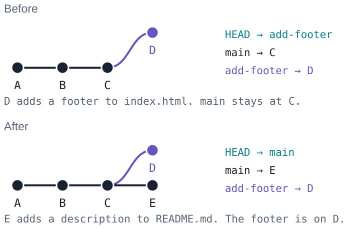
]
.clear[]

???
Add a blank line after the README heading, then the description. main and add-footer now both have a commit after C. E changes README.md, while D changes index.html. These changes can merge without a content conflict.

---
class: command
name: merge

# Merge the footer

.left[
```bash
git merge add-footer \
  -m "Merge footer"
```

Commit **M** has two parents: E and D.

The project now has the README description and the footer.

.gui-path[VS Code · On **main**, **Git: Merge…** → `add-footer`.]
]
.right[
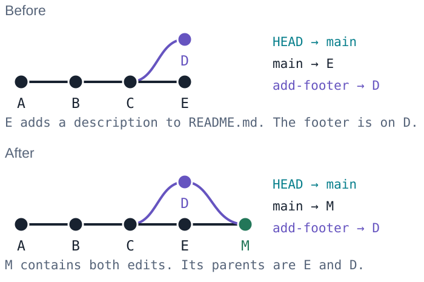
]
.clear[]

???
The GUI uses Git’s generated merge message unless you edit it; the CLI example sets Merge footer explicitly. The state shown is the same two-parent merge.

This is a true merge, unlike the earlier fast-forward. Verify with git log --oneline --graph --all --decorate. The local add-footer branch still points to D after merging. Source: https://git-scm.com/docs/git-merge#_true_merge

---
class: compare compact-code
name: conflict

# If both branches edit the same line

.left[
<pre class="conflict-code"><code>&lt;&lt;&lt;&lt;&lt;&lt;&lt; HEAD
&lt;h1&gt;Our homepage&lt;/h1&gt;
&#61;&#61;&#61;&#61;&#61;&#61;&#61;
&lt;h1&gt;Your homepage&lt;/h1&gt;
&gt;&gt;&gt;&gt;&gt;&gt;&gt; conflict-incoming</code></pre>
]
.right[
Git may ask you to resolve a conflict.

Choose the final text, remove the markers, and review the result.

```bash
git add index.html
git commit
```
]
.clear[]

.note[To cancel an in-progress merge: `git merge --abort`.]

???
This is an alternative conflict example, not the outcome of our preceding merge. Our preceding commits changed different files and merged cleanly. Start a merge with a clean working tree; abort is easiest when there are no unrelated local edits to preserve. Source: https://git-scm.com/docs/git-merge#_how_conflicts_are_presented

---
class: gui-conflict
name: conflict-vscode

# Resolve a conflict in VS Code

Open `index.html` under **Merge Changes**. Choose a side, or edit **Result** yourself.

.gui-merge[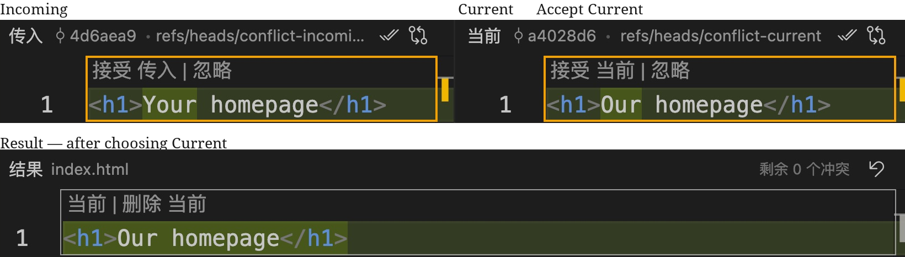]

**Complete Merge** resolves the file. **Continue** commits the merge.

???
These are labeled crops from the real built-in Merge Editor: the inputs before choosing Current and the result afterward. The top left input is Incoming; the top right input is Current. Neither side is automatically the correct answer. Review the result and run the project before completing the merge. The current-side result equals the current commit in this separate example, so git status may list no file difference after resolution even though MERGE_HEAD still exists. Complete Merge does not by itself create the merge commit: that was verified against HEAD and MERGE_HEAD. Continue completes the pending merge, corresponding to git commit; resolving/saving and staging correspond to the previous slide’s git add. This is the same alternative conflict example, not a conflict in our clean footer merge. If clicking a conflict opens a text editor, use Open in Merge Editor, or enable git.mergeEditor. Source: https://code.visualstudio.com/docs/sourcecontrol/merge-conflicts

---
class: reference
name: undo

# Undo: choose the scope

| Intent | Command | Result |
| --- | --- | --- |
| Unstage | `git restore --staged index.html` | Keeps your working edits. |
| Discard an unstaged edit | `git restore index.html` | Replaces the file with staged content. |
| Reverse a saved commit | `git revert <commit-id>` | Creates a new reversing commit. |

Discarded, uncommitted edits may be unrecoverable. Check `git diff` first.

???
These are reference commands, not steps to execute in the ongoing project. --staged restores the index from HEAD by default. Plain restore uses the index by default. The first example assumes an existing commit. Revert can conflict; merge commits need extra handling. checkout also switches branches and revisions, so restore is not a universal rename of checkout. Sources: https://git-scm.com/docs/git-restore and https://git-scm.com/docs/git-revert

---
class: command
name: local-remote

# Connect this project to GitHub

.left[
Create an empty GitHub repository named `my-first-project`.

```bash
git remote add origin \
  <repo-url>
```

Replace `<repo-url>` with its HTTPS or SSH URL.
]
.right[
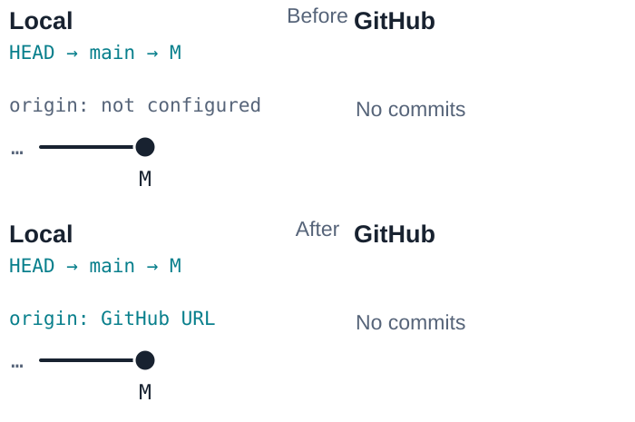
]
.clear[]

???
Use your own account and an empty remote: do not initialize it with another README, license or gitignore in this exercise. Adding origin saves a URL in local configuration. It does not upload commits. You need network access, authentication and write permission for the next push. Account passwords are not accepted for HTTPS Git operations. Sources: https://git-scm.com/docs/git-remote and https://docs.github.com/en/authentication/keeping-your-account-and-data-secure/about-authentication-to-github

---
class: command
name: push

# git push

.left[
```bash
git push -u origin main
```

GitHub now has the history through M.

.gui-path[VS Code · With `origin` already added, choose **Publish Branch** for the first push.]

.gui-shot[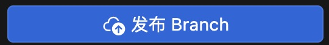]

This also sets the upstream. Later, use **Git: Push**.
]
.right[
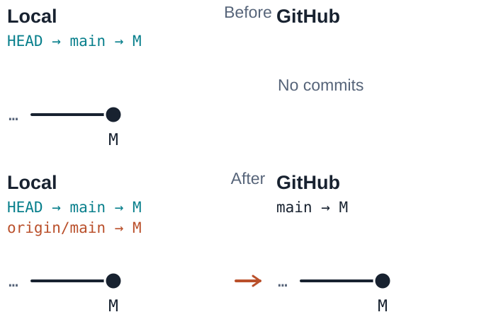
]
.clear[]

???
With origin already configured and no upstream on main, the real Publish Branch action was checked against a local bare remote: it pushed main and set origin/main as upstream. Publish to GitHub is a separate action that can create a new GitHub repository; do not choose it here. Sync Changes pulls then pushes, so it is not a synonym for Push. Authentication and repository permissions still apply when origin is GitHub. Source: https://code.visualstudio.com/docs/sourcecontrol/repos-remotes

Only main is pushed as a named branch. The commits reachable from it include the merged feature work, but the local feature branch names are not automatically created remotely. origin/main is a local remote-tracking reference. Source: https://git-scm.com/docs/git-push

---
class: command compact-code
name: clone

# git clone

.left[
On a second computer:

```bash
git clone <repo-url>
cd my-first-project
```

You get working files, Git history, and an `origin` remote.

.gui-path[VS Code · **Git: Clone** → paste the repository URL → choose a destination folder → open the clone.]
]
.right[
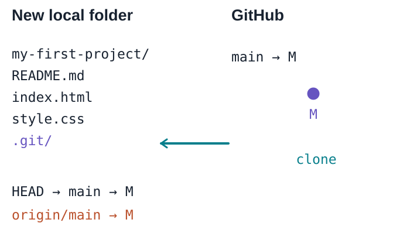
]
.clear[]

???
Use the same remote URL. On the same computer, clone into a different directory to avoid a folder-name collision. A normal clone fetches branch history and checks out one branch; shallow and partial clones are exceptions to a complete local copy. GitHub PR discussions and checks are service data, not part of a Git clone. Source: https://git-scm.com/docs/git-clone

---
class: command
name: fetch

# git fetch

.left[
A teammate adds commit **N** to the shared `main`.

```bash
git fetch origin
```

`origin/main` advances to N.

Your `main` and working files stay at M.

.gui-path[VS Code · Command Palette → **Git: Fetch**.]
]
.right[
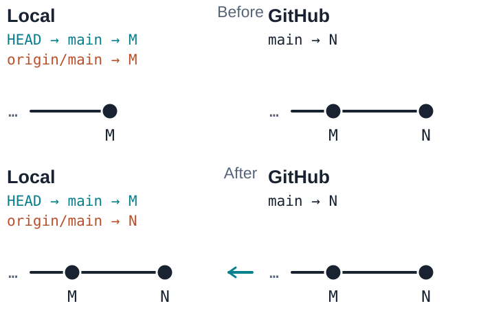
]
.clear[]

???
The exact Git: Fetch action was selected rather than Fetch From All Remotes. The teaching repository has one origin. After the GUI fetch, origin/main moved to N while local main, HEAD and the working README remained at M. Source: https://code.visualstudio.com/docs/sourcecontrol/repos-remotes

For a live demo, make a README change in the second clone and push it, or edit the README on GitHub if repository rules allow it. Return to the original clone before fetching. Here N adds an About paragraph to README.md. Source: https://git-scm.com/docs/git-fetch

---
class: command
name: pull

# git pull

.left[
```bash
git pull --ff-only
```

Pull fetches, then integrates into your current branch.

Here, `main` advances to N and the working README updates.

.gui-path[VS Code · **Git: Pull** uses your Git pull settings. For the same fast-forward-only rule, set `git config pull.ff only` in this repository first.]
]
.right[
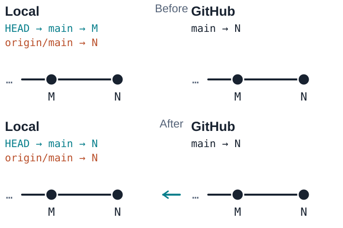
]
.clear[]

???
The GUI Pull was executed after configuring pull.ff=only locally in the dedicated demo repository. It advanced HEAD/main to N and updated the README. Without that setting, Pull can merge or rebase according to the configuration. Sync Changes also pushes afterward and is not used for this step. Source: https://code.visualstudio.com/docs/sourcecontrol/repos-remotes

The current branch is main, it tracks origin/main, and the working tree is clean. The preceding fetch already obtained N, so this pull's fetch has nothing new to download before integration. --ff-only stops when histories diverge. Other pull options or settings can integrate by merge or rebase. Source: https://git-scm.com/docs/git-pull

---
name: remote-summary

# Four different operations

| Command | What it does |
| --- | --- |
| `git clone <url>` | Creates a new local repository and working files. |
| `git push` | Shares committed history on a remote branch. |
| `git fetch` | Downloads history and updates remote-tracking references. |
| `git pull` | Fetches, then integrates into the current branch. |

In VS Code, **Sync Changes pulls, then pushes**.
Choose **Fetch**, **Pull**, or **Push** when you want one operation.

???
Angle brackets mark placeholders. Fetch does not integrate into the current branch or update working files. Push and pull do not make every branch on two computers identical. Sources: https://git-scm.com/docs/git-clone, https://git-scm.com/docs/git-push, https://git-scm.com/docs/git-fetch and https://git-scm.com/docs/git-pull

---
name: github-flow

# Working together on GitHub

A pull request asks the team to review and merge a branch.

.figure[]

After merging, update your local `main`.

???
A pull request is a GitHub object, not a Git command. We will continue in the same project, starting at N. This is a branch workflow in a repository where you have write access. Contributions through forks can be taught later. Source: https://docs.github.com/en/get-started/using-github/github-flow

---
class: command compact-code
name: pr-start

# Prepare a README change

.left[
```bash
git switch -c improve-readme
```

.gui-path[VS Code · **Git: Create Branch…** → `improve-readme`.]

In `README.md`, add a Run section that says how to open `index.html`.

```bash
git add README.md
git commit -m \
  "Add run instructions"
```
]
.right[
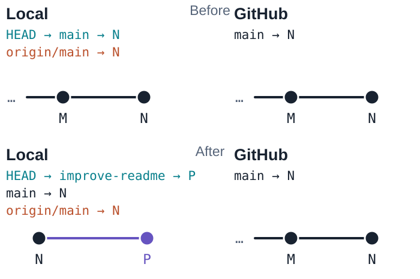
]
.clear[]

???
Continue after the pull at N, with a clean working tree. Retain the README heading, description and teammate's About paragraph. P adds the Run section. The instructor can let learners choose their own short README improvement instead, while keeping the branch and snapshot relationships the same.

---
class: command
name: pr-push

# Push the branch

.left[
```bash
git push -u origin \
  improve-readme
```

GitHub now has `improve-readme` at P.

Its `main` is still at N.

.gui-path[VS Code · **Publish Branch** on `improve-readme`. This shares the branch; it does not open a pull request.]
]
.right[
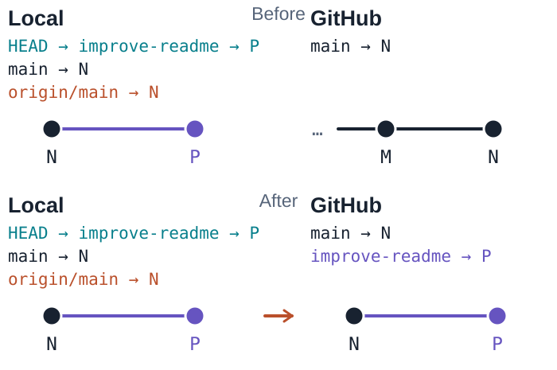
]
.clear[]

???
Pushing a feature branch does not merge it into main or create a PR automatically. A normal push updates the corresponding local remote-tracking reference as well; the diagram focuses on main and the named local feature branch. Source: https://git-scm.com/docs/git-push

---
name: open-pr

# Open a pull request

On GitHub, choose:

<div class="pr-comparison">base: main ← compare: improve-readme</div>

Title: **Add run instructions**

.diff[
```diff
+## Run
+Open index.html in a browser.
```
]

`main` is the branch that will receive the change.

???
The diff is simplified, with file headers and context omitted. On Pull requests, choose New pull request, select the base and compare branches, read the diff and create the PR. Explain why the change helps readers. Source: https://docs.github.com/en/pull-requests/collaborating-with-pull-requests/proposing-changes-to-your-work-with-pull-requests/creating-a-pull-request

---
class: command
name: review

# Review, then merge

.left[
Read the diff and discuss any changes.

To address feedback, commit on the same branch and push again.

When ready, choose **Create a merge commit** on GitHub.
]
.right[
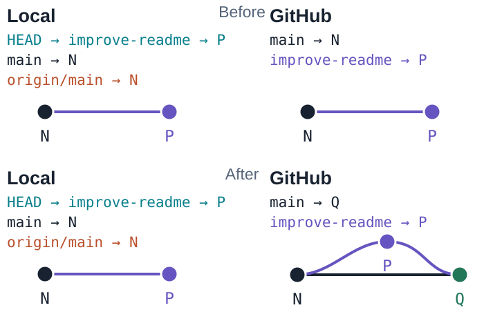
]
.clear[]

???
Follow the repository's required checks, approvals and permissions. Checks only appear when configured. This diagram uses GitHub's merge-commit method, which creates a two-parent commit even when a fast-forward would be possible. Squash and rebase methods produce different histories. New commits on the same branch update the PR automatically. Source: https://docs.github.com/en/get-started/using-github/github-flow

---
class: command
name: merge-and-sync

# Get the merged version

.left[
```bash
git switch main
git pull --ff-only
```

`main` and `origin/main` now point to Q.

Your local feature branch stays at P.

.gui-path[VS Code · Switch to **main**, then **Git: Pull** with the same pull settings.]
]
.right[
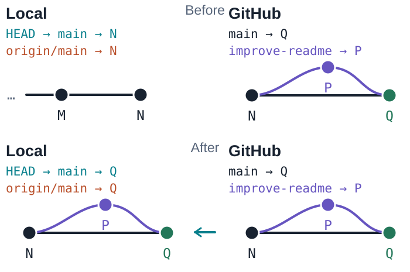
]
.clear[]

???
The Before diagram starts after git switch main; switching first changes HEAD and checks out N. Pull then fetches Q and fast-forwards main. The README now contains the reviewed Run section. A fully merged local branch can later be removed with git branch -d improve-readme. Source: https://docs.github.com/en/get-started/using-github/github-flow

---
class: compact-code
name: rejected-push

# If a push is rejected

.output[
```text
! [rejected] main -> main (non-fast-forward)
```
]

```bash
git fetch origin
git log --oneline --graph --all --decorate
```

Inspect the histories, then use your team's merge or rebase workflow.

Do not force-push a shared branch to get past the error.

???
This is a separate what-if scenario after the contribution. A non-fast-forward rejection means the remote tip is not an ancestor of the proposed new tip. Other errors can be authentication, permissions, protection rules or network failures; read the actual error. Source: https://docs.github.com/en/get-started/using-git/dealing-with-non-fast-forward-errors

---
class: compare
name: ignore

# Keep local files out of commits

.left[
An example `.gitignore`:

```text
.env
.DS_Store
build/
```
]
.right[
Review before committing:

```bash
git status
git diff --staged
```

An ignore rule does not remove files that Git already tracks.
]
.clear[]

.note[If a secret leaks, revoke it. Deleting it in a later commit does not erase the old history.]

???
Patterns depend on the project; these are examples, not required files in the running exercise. Normally commit .gitignore itself. If sensitive data was published, follow the host's remediation guide. Sources: https://git-scm.com/docs/gitignore and https://docs.github.com/en/authentication/keeping-your-account-and-data-secure/removing-sensitive-data-from-a-repository

---
class: command-reference
name: reference

# Commands to keep nearby

.left[
## Inspect

.command-list[`git status`<br>`git diff`<br>`git diff --staged`<br>`git log --oneline`]

## Save

.command-list[`git add <file>`<br>`git commit -m "Message"`]
]
.right[
## Branch

.command-list[`git branch <name>`<br>`git switch <name>`<br>`git merge <name>`]

## Share

.command-list[`git push`<br>`git fetch`<br>`git pull --ff-only`]
]
.clear[]

???
Use main before merging a feature into main or pulling updates for main. Inspect and preserve unfinished work before switching or integrating. Angle brackets mark placeholders. Git's command reference: https://git-scm.com/docs . Further reading: https://git-scm.com/book/en/v2 and https://docs.github.com/en/get-started/using-github/github-flow . Small commits, focused PRs, and clear messages make reviews easier. GUI and AI tools still require you to read the diff.

---
class: closing
name: thank-you

# Thank You

.subtitle[Tianyou Yu]

???
Invite questions about the learner's own next change. The published course and source repository are linked from the project README. No extra closing slogan is needed.
